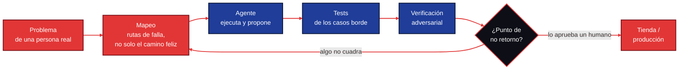
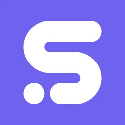
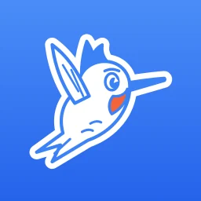
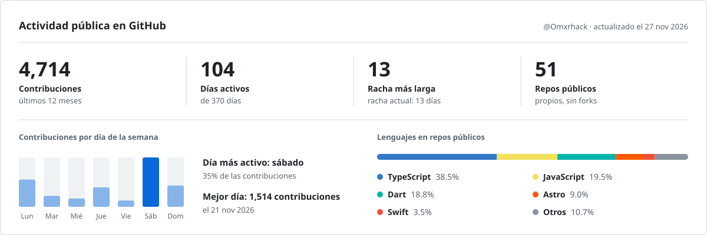

<!-- ══════════════════════════════════════════════════════════════════════
     README de perfil · Omar Bermejo Osuna (@Omxrhack) · edición Spider-Man
     Arte (header, divisores, footer):  node scripts/art.mjs
     Spider-Sense (stats + telaraña):   .github/workflows/spider-sense.yml
     ══════════════════════════════════════════════════════════════════════ -->

<div align="center">

<picture>
  <source media="(prefers-color-scheme: dark)" srcset="assets/header-dark.svg">
  <source media="(prefers-color-scheme: light)" srcset="assets/header-light.svg">
  
</picture>

<a href="#origen"></a>
<a href="#misiones"></a>
<a href="#skills"></a>
<a href="#multiverso"></a>
<a href="#spider-sense"></a>
<a href="#contacto"></a>

<br>


<a href="https://github.com/Omxrhack?tab=followers"></a>


<br><br>

<a href="https://github.com/Omxrhack">
  <picture>
    <source media="(prefers-color-scheme: dark)" srcset="https://raw.githubusercontent.com/Omxrhack/Omxrhack/output/spider-calendar-dark.svg">
    <source media="(prefers-color-scheme: light)" srcset="https://raw.githubusercontent.com/Omxrhack/Omxrhack/output/spider-calendar-light.svg">
    
  </picture>
</a>

</div>


## Origen

Construyo **aplicaciones móviles que llegan a tienda** y los **sistemas que las sostienen**. Trabajo desde Culiacán, con producto propio en producción y clientes que necesitan software que aguante el uso diario.

```ts
// friendly-neighborhood-dev.ts
const omar = {
  identidadSecreta: "Omar Bermejo Osuna",
  alias:            "@Omxrhack",
  base:             "Culiacán, Sinaloa · MX",
  formacion:        "Ingeniería en TIC · Instituto Tecnológico de Culiacán (TecNM)",
  ahoraMismo:       ["CTO de Socialler", "construyendo Blyni", "Easy Order en tiendas"],
  poderes:          ["iOS", "Android", "React Native / Expo", "Flutter", "Backend", "Rust", "Agentes de IA"],
  sentidoAracnido:  "detecta las rutas de falla antes que el camino feliz",
  responsabilidad:  "software que resuelva algo medible para alguien concreto",
} as const;
```

#### Cómo trabajo con agentes · células 1+1

Un humano, un agente. El agente ejecuta y propone; los puntos de no retorno los aprueba una persona. **Entrego con pruebas, no con promesas.**




## Misiones

Lo que tengo en el aire ahora mismo.

<table>
<tr>
<td width="50%" valign="top">



### Socialler
**Red social de entretenimiento colaborativo** para creadores de contenido, en español, inglés y portugués. Soy **CTO de Fénix**, la reescritura: un servicio por dominio unidos en un grafo GraphQL federado, eventos en NATS y push en tiempo real por APNs y FCM.

`React Native / Expo` `NestJS` `GraphQL Federation` `NATS` `PostgreSQL` `AWS`

<a href="https://www.socialler.com"></a>


</td>
<td width="50%" valign="top">



### Blyni
**Navegador ligero para macOS y Windows**, escrito en Rust. Reparte las pestañas en tres niveles —caliente, tibia y fría— para que solo las que usas ocupen memoria, y bloquea anuncios con el motor de Brave. Un binario de unos 2 MB.

`Rust` `AppKit / WebKit` `Win32 / WebView2` `gRPC`


</td>
</tr>
<tr>
<td width="50%" valign="top">

### 🍽️ Easy Order
Suite de **gestión para restaurantes**. La comanda va del teléfono del mesero a la pantalla de cocina en el momento, el inventario baja por receta y el corte de caja se cierra con el turno. Multi-tenant con cuatro roles.

`React Native / Expo` `Next.js` `NestJS` `AWS`

<a href="https://apps.apple.com/us/app/easy-order/id6767426566"></a>
<a href="https://play.google.com/store/apps/details?id=com.easyorder.easyorderv1"></a>


</td>
<td width="50%" valign="top">

### 🎙️ anottan
App iOS de **chat, proyectos y asistente de voz “Bea”**. Hablas, Bea transcribe en tiempo real y clasifica lo dicho en notas, tareas o el proyecto al que pertenece.

`SwiftUI` `Swift` `Node.js`

<a href="https://apps.apple.com/us/app/anottan/id6798854468"></a>
<a href="https://anottan.com"></a>


</td>
</tr>
<tr>
<td width="50%" valign="top">

### 🕸️ Motor IA-First
Mi **metodología de desarrollo con agentes**: células 1+1 humano-agente, un flujo fijo de seis pasos y autonomía L2. Es el método con el que construyo todo lo demás.

`Claude Code` `Agentes` `MCP` `CI`


</td>
<td width="50%" valign="top">

### 🐾 Petixfy
**Recomendador de productos para mascotas** con IA. Toma especie, edad, peso y condición del animal y ordena los productos por qué tan bien encajan, con la razón a la vista.

`SwiftUI` `Python (FastAPI)` `DotLottie`

<a href="https://github.com/Omxrhack/petixfy"></a>
<a href="https://github.com/Omxrhack/petixfy-backend"></a>


</td>
</tr>
</table>


## Skills

<div align="center">

<sub><b>MÓVIL · EL LANZATELARAÑAS PRINCIPAL</b></sub><br>


<sub><b>BACKEND &amp; DATOS</b></sub><br>


<sub><b>WEB</b></sub><br>


<sub><b>ESCRITORIO &amp; SISTEMAS</b></sub><br>


<sub><b>NUBE, DEVOPS &amp; DISEÑO</b></sub><br>


<br>


</div>

<br>

| | Skill | Qué hago con ella |
|:-:|---|---|
| 📱 | **Móvil** | iOS y Android nativos (SwiftUI, Jetpack Compose), React Native / Expo y Flutter. De la primera pantalla a la publicación en tienda. |
| 🧩 | **Backend** | APIs en NestJS, Express y FastAPI; GraphQL federado y eventos con NATS. Multi-tenancy, migraciones y despliegue en AWS. |
| 🖥️ | **Escritorio** | Rust con capas nativas: AppKit y WebKit en macOS, Win32 y WebView2 en Windows, contratos gRPC. |
| 🌐 | **Web** | Next.js y Astro, con SEO desde la arquitectura y no como parche final. |
| 🤖 | **IA aplicada** | Agentes en el flujo de desarrollo, visión por computadora y sistemas de recomendación en producto real. |
| 🎨 | **Producto** | Identidad visual, diseño de interfaz y decisiones de alcance. El diseño no llega después del código. |
| 🧭 | **Proceso** | Metodología IA-First propia, gobernanza de TI con ITIL y COBIT, operación en Scrum. |


## Multiverso

Cada proyecto es un universo distinto. **Abre una dimensión** para ver qué hay dentro.

<details open>
<summary><b>Tierra-616 · Producto</b> — apps y plataformas con usuarios reales</summary>
<br>

| Proyecto | Qué resuelve | Stack | Ver |
|---|---|---|---|
| **Socialler** | Red social de entretenimiento colaborativo para creadores (ES · EN · PT) | `RN / Expo` `NestJS` `GraphQL` `NATS` | [sitio](https://www.socialler.com) |
| **Blyni** | Navegador ligero que congela las pestañas que no usas, para macOS y Windows | `Rust` `WebKit` `WebView2` | — |
| **Easy Order** | Gestión de restaurantes: comandas, cocina, inventario y corte de caja | `RN / Expo` `Next.js` `NestJS` `AWS` | [App Store](https://apps.apple.com/us/app/easy-order/id6767426566) · [Google Play](https://play.google.com/store/apps/details?id=com.easyorder.easyorderv1) |
| **anottan** | Chat, proyectos y asistente de voz “Bea” | `SwiftUI` `Node.js` | [App Store](https://apps.apple.com/us/app/anottan/id6798854468) · [sitio](https://anottan.com) |
| **cudmy** | Cursos en línea con rutas de carrera, inscripciones y progreso | `Next.js` `GSAP` `NestJS` | [front](https://github.com/Omxrhack/cudmy) · [backend](https://github.com/Omxrhack/cudmy-backend) |
| **Petixfy** | Recomendador de productos para mascotas con IA | `SwiftUI` `FastAPI` | [app](https://github.com/Omxrhack/petixfy) · [backend](https://github.com/Omxrhack/petixfy-backend) · [web](https://github.com/Omxrhack/petixfy-nexts-js) |
| **VetGo** | Expediente veterinario multi-rol: clínica, recepción y dueño | `RN / Expo` `NestJS` `PostgreSQL` | [repo](https://github.com/Omxrhack/vetgo) |
| **PR Friends** | Salidas con amigos sin perderse en el chat grupal | `RN / Expo` `Supabase` | [móvil](https://github.com/Omxrhack/pr-friends-movil) · [backend](https://github.com/Omxrhack/pr-friends-backend) |
| **tdapp** | Tareas por categoría de enfoque, con widgets nativos | `SwiftUI` `Kotlin` `Express` | [landing](https://github.com/Omxrhack/tdapp-landing) |
| **doplans** | Descubrir destinos y planear el evento en el mismo lugar | `Next.js` `RN / Expo` | [landing](https://github.com/Omxrhack/landing-doplans) |
| **bimoora** | Validar demanda antes de construir: landing, registro y SEO | `Astro` `schema.org` | [landing](https://github.com/Omxrhack/bimoora-coming-soon) |
| **memuvi** | Archivo de recuerdos con estado de ánimo y canción | `RN / Expo` `Supabase` | — |
| **Vende Digital3** | Menús con QR y pedidos por WhatsApp, sin comisiones | `Next.js` `Cloudinary` | — |

</details>

<details>
<summary><b>Tierra-1610 · Sistemas</b> — métodos, visión por computadora y optimización</summary>
<br>

| Proyecto | Qué resuelve | Stack |
|---|---|---|
| **Motor IA-First** | Desarrollar con agentes sin acumular deuda técnica: células 1+1, autonomía L2 | `Claude Code` `Agentes` `CI` |
| **Reconocimiento de Matrículas** | Leer placas con la cámara del teléfono y cotejarlas contra un padrón | `SwiftUI` `FastAPI` `OpenCV` |
| **Optimización Metaheurística** | PSO y recocido simulado para rutas, turnos y asignación de recursos | `Python` `NumPy` |
| **Gobernanza de TI** | ITIL, COBIT, CMMI y Scrum aplicados a un área de sistemas real | `ITIL V3` `COBIT` `CMMI` |

</details>

<details>
<summary><b>Tierra-65 · Laboratorio</b> — prácticas y experimentos</summary>
<br>

| Proyecto | Qué es | Stack | Repo |
|---|---|---|---|
| **Sistema de Control Escolar** | Prueba técnica fullstack end-to-end | `TypeScript` `React` `Docker` | [repo](https://github.com/Omxrhack/prueba-tecnica-fullstack) |
| **Tópicos de IA** | Algoritmos de IA escritos desde cero antes de usar la librería | `Python` `scikit-learn` | [repo](https://github.com/Omxrhack/Topicos-de-IA---12-00-A-13-00-PM) |
| **Recetiin** | Recetas offline, con el paso actual siempre a la vista | `Swift` `SwiftUI` | [repo](https://github.com/Omxrhack/Recetiin) |
| **PelisApp** | Catálogo de películas con caché de respuestas e imágenes | `Flutter` `Dart` | [repo](https://github.com/Omxrhack/PelisAppFlutter) |
| **qaride** | Seguimiento en mapa con interpolación entre lecturas de GPS | `Flutter` `Dart` | [repo](https://github.com/Omxrhack/qaride) |

</details>

<details>
<summary><b>Tierra-138 · Landings</b> — sitios para marcas y lanzamientos</summary>
<br>

| Sitio | Para qué | Stack |
|---|---|---|
| [keyjo_sushi_landing](https://github.com/Omxrhack/keyjo_sushi_landing) | Landing para restaurante de sushi | `Astro` |
| [landing-yock-v1](https://github.com/Omxrhack/landing-yock-v1) | Landing de producto | `CSS` |
| [links-media-omxrhack](https://github.com/Omxrhack/links-media-omxrhack) | Hub de enlaces personal | `Astro` |
| [portafolio-2026](https://github.com/Omxrhack/portafolio-2026) | Portafolio tipográfico, sin dependencias de runtime | `Astro` `Tailwind` |

</details>


## Spider-Sense

<div align="center">

<picture>
  <source media="(prefers-color-scheme: dark)" srcset="https://raw.githubusercontent.com/Omxrhack/Omxrhack/output/spider-sense-dark.svg">
  <source media="(prefers-color-scheme: light)" srcset="https://raw.githubusercontent.com/Omxrhack/Omxrhack/output/spider-sense-light.svg">
  
</picture>

<sub>Generado a diario por <a href=".github/workflows/spider-sense.yml">GitHub Actions</a> con datos públicos de mi cuenta. Sin servicios de terceros.</sub>

</div>


## Contacto

<div align="center">

¿Tienes un problema que el software pueda resolver de verdad? **Lanza la señal.**

<a href="mailto:bermejoosuna@gmail.com"></a>
<a href="https://x.com/bermejoosuna"></a>
<a href="https://www.instagram.com/omarb03_/"></a>
<a href="https://www.threads.com/@omarb03_"></a>
<a href="https://github.com/Omxrhack"></a>

<br><br>

<details>
<summary><sub>🕷️ <i>¿Sentiste eso? Es el sentido arácnido…</i></sub></summary>
<br>

| Se activa cuando… | Y lo que hago |
|---|---|
| alguien hace `git push --force` a `main` | respiro hondo y reviso el reflog |
| hay un deploy en viernes a las 6 pm | pido que esperemos al lunes |
| una PR llega sin tests | la regreso con cariño |
| “en mi máquina sí funciona” | lo meto en CI hasta que funcione en todas |

</details>

<picture>
  <source media="(prefers-color-scheme: dark)" srcset="assets/footer-dark.svg">
  <source media="(prefers-color-scheme: light)" srcset="assets/footer-light.svg">
  
</picture>

</div>
