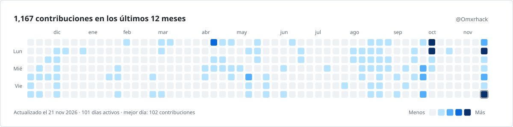

<!-- README de perfil · Omar Bermejo Osuna (@Omxrhack)
     Las tarjetas de actividad se generan dos veces al día: .github/workflows/spider-sense.yml -->

# Omar Bermejo Osuna

Desarrollador móvil · CTO de Socialler · Culiacán, Sinaloa, México

Construyo aplicaciones móviles que llegan a tienda y los sistemas que las sostienen. Tengo producto propio en producción y colaboro con clientes que necesitan software que aguante el uso diario.

Formación: Ingeniería en Tecnologías de la Información y Comunicaciones, Instituto Tecnológico de Culiacán (TecNM).

## Cómo trabajo

Desarrollo en pareja con agentes de IA: el agente ejecuta y propone, y las decisiones sin vuelta atrás las aprueba una persona. Antes de construir reviso cómo puede fallar algo, no solo el caso ideal, y entrego con pruebas.

## Proyectos actuales

<table>
<tr>
<td width="50%" valign="top">

### Socialler
CTO · Beta interna · [socialler.com](https://www.socialler.com)

Red social de entretenimiento colaborativo para creadores de contenido, en español, inglés y portugués. Dirijo Fénix, la reescritura de la plataforma: un servicio por dominio, unidos en un grafo GraphQL federado, eventos en NATS y notificaciones push en tiempo real con APNs y FCM.

React Native / Expo · NestJS · GraphQL Federation · NATS · PostgreSQL · AWS

</td>
<td width="50%" valign="top">

### Blyni
En desarrollo · v0.1 para macOS

Navegador ligero para macOS y Windows escrito en Rust. Reparte las pestañas en tres niveles (caliente, tibia y fría) para que solo las que se usan ocupen memoria, y bloquea anuncios con el motor de Brave. El binario pesa alrededor de 2 MB.

Rust · AppKit / WebKit · Win32 / WebView2 · gRPC

</td>
</tr>
<tr>
<td width="50%" valign="top">

### easy order
Publicada · [App Store](https://apps.apple.com/us/app/easy-order/id6767426566) · [Google Play](https://play.google.com/store/apps/details?id=com.easyorder.easyorderv1)

Gestión para restaurantes. La comanda pasa del teléfono del mesero a la pantalla de cocina al instante, el inventario se descuenta por receta y el corte de caja se cierra con el turno. Multi-tenant, con cuatro roles.

React Native / Expo · Next.js · NestJS · AWS

</td>
<td width="50%" valign="top">

### anottan
Publicada · [App Store](https://apps.apple.com/us/app/anottan/id6798854468) · [anottan.com](https://anottan.com)

App iOS de chat, proyectos y asistente de voz. Bea, la asistente, transcribe en tiempo real y clasifica lo dicho en notas, tareas o el proyecto al que pertenece.

SwiftUI · Swift · Node.js

</td>
</tr>
</table>

## Stack

| Área | Qué hago | Tecnologías |
|---|---|---|
| Móvil | Apps nativas y multiplataforma, de la primera pantalla a la publicación en tienda | Swift, SwiftUI, Kotlin, Jetpack Compose, React Native / Expo, Flutter, Dart |
| Backend | APIs, GraphQL federado, eventos, multi-tenancy y migraciones | Node.js, NestJS, Express, Python, FastAPI, GraphQL, NATS, gRPC |
| Datos | Bases de datos y backends gestionados | PostgreSQL, Supabase, Firebase |
| Web | Sitios y aplicaciones con SEO desde la arquitectura | TypeScript, JavaScript, Next.js, Astro, Tailwind CSS, GSAP |
| Escritorio | Rust con capas nativas por plataforma | Rust, AppKit, WebKit, Win32, WebView2 |
| Infraestructura | Despliegue, CI/CD y publicación en tiendas | AWS, Railway, Docker, GitHub Actions, App Store Connect, Google Play Console |
| IA aplicada | Agentes en el flujo de desarrollo, visión por computadora y sistemas de recomendación | Claude Code, MCP, OpenCV, scikit-learn |
| Producto y proceso | Diseño de interfaz, decisiones de alcance y gobernanza de TI | Figma, Scrum, ITIL, COBIT |

## Otros proyectos

<b>Producto</b>: apps y plataformas

 

| Proyecto | Qué resuelve | Stack | Enlaces |
|---|---|---|---|
| **Petixfy** | Recomendador de productos para mascotas con IA, según especie, edad, peso y condición | SwiftUI, FastAPI | [app](https://github.com/Omxrhack/petixfy) · [backend](https://github.com/Omxrhack/petixfy-backend) · [web](https://github.com/Omxrhack/petixfy-nexts-js) |
| **cudmy** | Cursos en línea con rutas de carrera, inscripciones y progreso | Next.js, GSAP, NestJS | [front](https://github.com/Omxrhack/cudmy) · [backend](https://github.com/Omxrhack/cudmy-backend) |
| **VetGo** | Expediente veterinario multi-rol: clínica, recepción y dueño | React Native / Expo, NestJS, PostgreSQL | [repo](https://github.com/Omxrhack/vetgo) |
| **PR Friends** | Organización de salidas con amigos fuera del chat grupal | React Native / Expo, Supabase | [móvil](https://github.com/Omxrhack/pr-friends-movil) · [backend](https://github.com/Omxrhack/pr-friends-backend) |
| **tdapp** | Tareas por categoría de enfoque, con widgets nativos | SwiftUI, Kotlin, Express | [landing](https://github.com/Omxrhack/tdapp-landing) |
| **doplans** | Descubrir destinos y planear el evento en el mismo lugar | Next.js, React Native / Expo | [landing](https://github.com/Omxrhack/landing-doplans) |
| **bimoora** | Validación de demanda antes de construir: landing, registro y SEO | Astro, schema.org | [landing](https://github.com/Omxrhack/bimoora-coming-soon) |
| **memuvi** | Archivo de recuerdos con estado de ánimo y canción | React Native / Expo, Supabase | |
| **Vende Digital3** | Menús con QR y pedidos por WhatsApp, sin comisiones | Next.js, Cloudinary | |

<b>Sistemas</b>: metodología, visión por computadora y optimización

 

| Proyecto | Qué resuelve | Stack |
|---|---|---|
| **Motor IA-First** | Metodología propia para desarrollar con agentes sin acumular deuda técnica: un humano y un agente por célula, flujo fijo de seis pasos | Claude Code, MCP, CI |
| **Reconocimiento de matrículas** | Lectura de placas con la cámara del teléfono y cotejo contra un padrón | SwiftUI, FastAPI, OpenCV |
| **Optimización metaheurística** | PSO y recocido simulado para rutas, turnos y asignación de recursos | Python, NumPy |
| **Gobernanza de TI** | ITIL, COBIT, CMMI y Scrum aplicados a un área de sistemas real | ITIL V3, COBIT, CMMI |

<b>Prácticas</b>: ejercicios técnicos y experimentos

 

| Proyecto | Qué es | Stack | Repo |
|---|---|---|---|
| **Sistema de control escolar** | Prueba técnica fullstack de punta a punta | TypeScript, React, Docker | [repo](https://github.com/Omxrhack/prueba-tecnica-fullstack) |
| **Tópicos de IA** | Algoritmos de IA implementados desde cero antes de usar la librería | Python, scikit-learn | [repo](https://github.com/Omxrhack/Topicos-de-IA---12-00-A-13-00-PM) |
| **Recetiin** | Recetas sin conexión, con el paso actual siempre a la vista | Swift, SwiftUI | [repo](https://github.com/Omxrhack/Recetiin) |
| **PelisApp** | Catálogo de películas con caché de respuestas e imágenes | Flutter, Dart | [repo](https://github.com/Omxrhack/PelisAppFlutter) |
| **qaride** | Seguimiento en mapa con interpolación entre lecturas de GPS | Flutter, Dart | [repo](https://github.com/Omxrhack/qaride) |

<b>Sitios</b>: landings para marcas y lanzamientos

 

| Sitio | Para qué | Stack |
|---|---|---|
| [keyjo_sushi_landing](https://github.com/Omxrhack/keyjo_sushi_landing) | Landing para restaurante de sushi | Astro |
| [landing-yock-v1](https://github.com/Omxrhack/landing-yock-v1) | Landing de producto | CSS |
| [links-media-omxrhack](https://github.com/Omxrhack/links-media-omxrhack) | Página de enlaces personal | Astro |
| [portafolio-2026](https://github.com/Omxrhack/portafolio-2026) | Portafolio tipográfico, sin dependencias de runtime | Astro, Tailwind CSS |

## Actividad en GitHub

<picture>
  <source media="(prefers-color-scheme: dark)" srcset="https://raw.githubusercontent.com/Omxrhack/Omxrhack/output/spider-sense-dark.svg">
  <source media="(prefers-color-scheme: light)" srcset="https://raw.githubusercontent.com/Omxrhack/Omxrhack/output/spider-sense-light.svg">
  
</picture>

<picture>
  <source media="(prefers-color-scheme: dark)" srcset="https://raw.githubusercontent.com/Omxrhack/Omxrhack/output/spider-calendar-dark.svg">
  <source media="(prefers-color-scheme: light)" srcset="https://raw.githubusercontent.com/Omxrhack/Omxrhack/output/spider-calendar-light.svg">
  
</picture>

Se actualiza dos veces al día con <a href=".github/workflows/spider-sense.yml">GitHub Actions</a>, a partir de los datos públicos de la cuenta y sin servicios de terceros.

## Contacto

Abierto a colaboraciones de producto. Si tienes un problema que el software pueda resolver, escríbeme.

[Correo](mailto:bermejoosuna@gmail.com) · [X](https://x.com/bermejoosuna) · [Instagram](https://www.instagram.com/omarb03_/) · [Threads](https://www.threads.com/@omarb03_)
